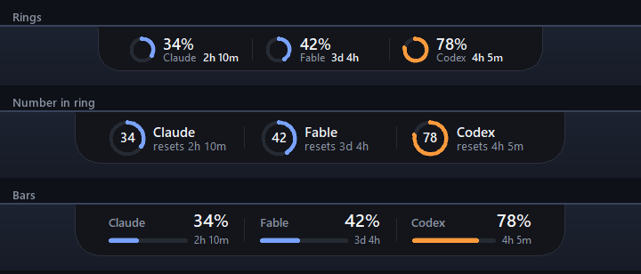
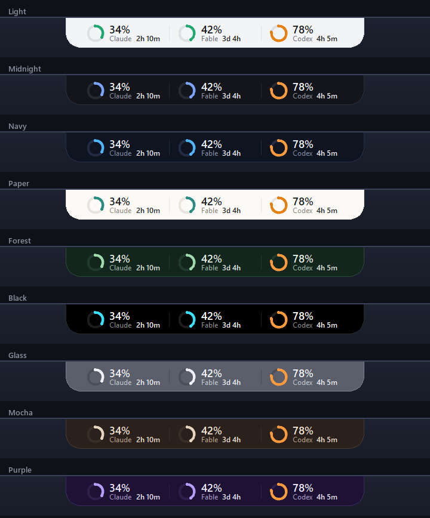
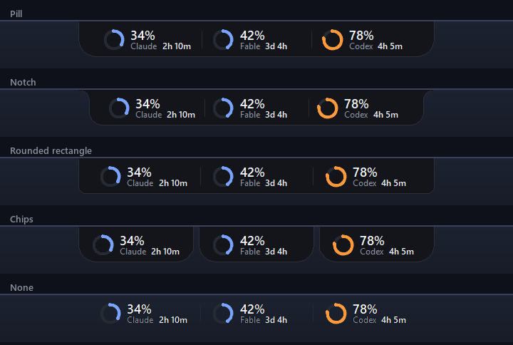
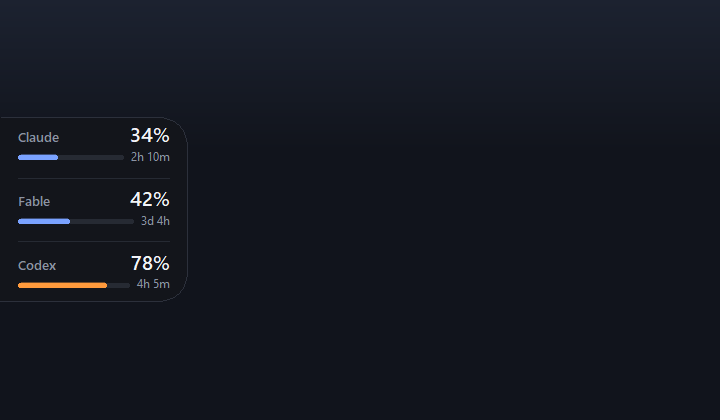
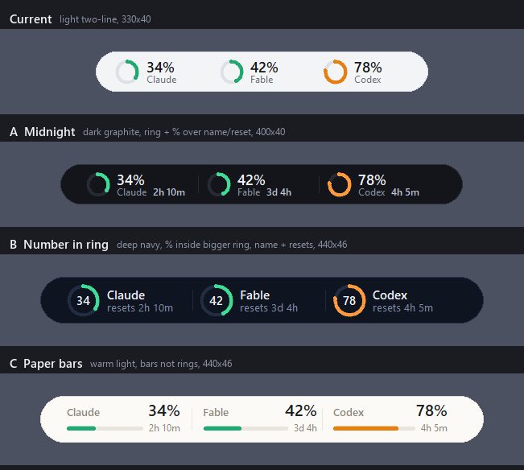

# AI Usage Rings

I'm happy to share a little tool I built for myself. Three rings sit at the top of my screen and show how much
of my Claude Code, Fable and Codex usage I've used up, when an agent is thinking, and when Claude is waiting
on me.

## Why I built it

I use Claude Code and Codex every day, and I wanted a better way to keep track of my credits without opening
a usage page every time. I also like to step away while an agent works, so I wanted to know at a glance when
it needs me.

Then I came across [Codenotch](https://github.com/vinzdg/codenotch) by [Vinz](https://github.com/vinzdg) in a
reel, and it was exactly the idea I was looking for. Instead of installing it, I wanted to build my own version so I could learn how it works:
just the tools I actually use, in one Python file, with nothing extra to install.

## What it shows

**Thinking.** When an agent is working, its ring spins. I can look up from whatever I'm doing and see if
it's still going.

**Waiting on me.** When Claude needs my approval, its ring turns amber, so it never sits there stuck on a
question I didn't see.

**Close to the limit.** Each ring fills up as I use my credits. It stays in the theme's colour under 70%,
then turns orange from 70% and red from 90%.

**The details.** Hovering over the pill shows every limit, how much of it I've used, and when it resets.

The Claude ring follows the 5-hour session limit, because that's the one that resets soonest and the one
that can stop me in the middle of a task. The weekly numbers are still there when I hover. Fable gets its
own ring because it has its own weekly allowance on the Max plan.

## Make it yours

I wanted to be able to change how it looks without opening a settings window, so everything is on the
right-click menu. It switches right away and remembers what I picked.

**Layout.** There are three: rings with the percent next to them, the percent inside a bigger ring, or thin
bars. All of them show when each limit resets, like `2h 10m` for the 5-hour window or `3d 4h` for a weekly
one, so I don't have to hover to find out.

**Color.** There are nine themes, from Light and Paper to Midnight, Forest, Mocha and Purple. The rings change
to match the theme, but orange, red and amber still mean the same thing in all of them.

**Shape.** It can be a pill, a notch, a rounded rectangle, three separate chips, or nothing behind it at all.
With no background, Windows lets clicks go right through the empty space, so I right-click on the rings or the
numbers instead.

**Where it sits.** It's locked in place so I can't bump it by accident. To move it, I right-click, choose Move
and drag it. When I let go, it snaps to the closest of eight spots, glides there and locks again. No matter
the shape, it sits right up against the edge of the screen, and on the left or right side it turns into a
skinny column so it doesn't stick out into whatever I'm working on.

Double-click refreshes it, and the right-click menu also has refresh and quit.

## How I designed it

I wanted it to feel like part of Windows and not just another window I have to deal with, so I tried to follow
a few UI design habits along the way.

The biggest one was comparing real screenshots instead of mockups. Every time I wanted to change something, I
rendered the actual widget with fake numbers, put the options side by side and picked from there. The first
round was three new looks next to the old one, and I ended up liking most of them, which is how the Layout and
Color menus happened. A sketch never looks quite like the real thing, and the real thing is what I'm looking
at all day. You can see the first round of options next to the old look below.

I also made the most important thing the biggest. When I glance at it, I only need to know how much I've used,
so the percent stands out and the name and reset time are smaller. Everything else is in the hover details.

Colors had to mean something too. Each theme has its own ring color, but orange always means I'm past 70%, red
means I'm past 90%, and amber means Claude is waiting on me. I can change how it looks without changing what
it's telling me.

And I wanted it to stay out of the way. It hugs the edge of the screen, the side touching the edge is flat,
and it stays locked unless I choose to move it. When it does move, the glide only takes about 250
milliseconds, and the edge flashes blue for a moment so I know it locked back in place. All the options live
in the right-click menu, so the pill itself never needs a single button.

## How to run it

You'll need Windows 10 or 11, Python 3 (I tested it on 3.11), and to be signed in to Claude Code, Codex,
or both.

    py -3 notch.py

`notch.cmd` starts it without a console window. If you want it to start with Windows, put a shortcut to
`notch.cmd` in the folder that opens when you type `shell:startup` into the Run box.

To get the amber "waiting" ring for Claude, install the hooks once:

    py -3 notch.py --install-hooks

This adds a few entries to `~/.claude/settings.json` without touching any hooks you already have, and it
won't write anything if that file isn't valid JSON. `py -3 notch.py --uninstall-hooks` takes out exactly
what it added. New Claude Code sessions pick them up.

## Where the numbers come from, in plain English

- **Claude Code:** it reads the login token Claude Code already saves on your computer
  (`~/.claude/.credentials.json`) and asks Anthropic's usage endpoint how much you've used. The token goes
  stale about eight hours after your last `claude` command, so if the pill says "token expired", run any
  `claude` command and it picks back up.
- **Codex:** same idea, with the token Codex saves in `~/.codex/auth.json`. If that doesn't work, it falls
  back to the last usage numbers in your newest Codex session log.
- **Thinking and waiting:** Claude tells the pill what it's doing through the hooks above. Codex doesn't
  have hooks, so the pill reads the end of its newest session log instead. Because of that, it can't tell
  the difference between Codex running a tool and Codex waiting for your approval, so the Codex ring never
  turns amber.

Your tokens are only ever read. They are never changed, copied anywhere else, or logged. One heads up:
neither Anthropic nor OpenAI publishes these usage endpoints as official APIs, so they could change without
warning. If a ring stops updating, hover over the pill and the error will show there.

## What I learned building it

- **It was blurry on my screen.** My laptop runs at 125% scaling, and Windows was stretching the window,
  which made everything fuzzy. One `SetProcessDpiAwareness` call tells Windows the app handles its own
  scaling, and scaling every size myself made it sharp.
- **Tkinter rings look jagged.** Tkinter draws arcs with hard edges, so each ring gets a faint halo arc
  underneath and rounded ends to smooth it out.
- **It stopped updating once.** I accidentally had two copies running, they fought over the same file, and
  the rings froze without any error. Now each update always schedules the next one even when something
  fails, the error shows up when you hover, and a second copy just closes itself.

## Check

    py -3 notch.py --selftest

## Thanks

Big thanks to Vinz ([@vinzdg](https://github.com/vinzdg)) for
[Codenotch](https://github.com/vinzdg/codenotch), which this project is based on. I found it through a reel.
It's a free, open-source Mac app that pins a small notch to the edge of your screen with usage rings for a ton
of AI coding tools, like Claude Code, Codex and Cursor. A lot of the ideas here came straight from it: a ring
for each tool, the spinning arc while an agent works, the amber ring when it's waiting on you, the limits and
reset times on hover, and even the timings I use to tell when Codex is busy. It also already sits on any edge
of the screen and turns into a column on the sides, which I actually only found out after building mine. Mine
is a much smaller Windows version in one Python file, so if you're on a Mac or want a lot more tools than
these three, definitely check out Codenotch. Its repo has a Windows version too.

I'm really proud of how this turned out, and if you try it, I would love to hear what you think!!
