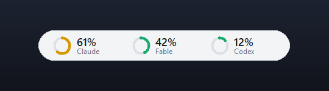
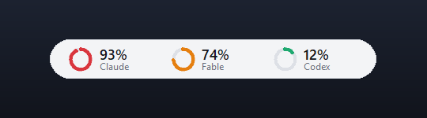
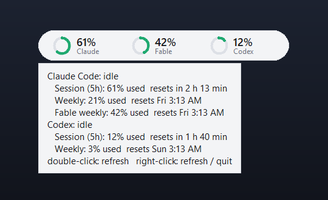

# AI Usage Rings

I'm happy to share a little tool I built for myself. Three rings sit at the top of my screen and show how much
of my Claude Code, Fable and Codex usage I've used up, when an agent is thinking, and when Claude is waiting
on me.

## Why I built it

I use Claude Code and Codex every day, and I wanted a better way to keep track of my credits without opening
a usage page every time. I also like to step away while an agent works, so I wanted to know at a glance when
it needs me.

Then I came across [Codenotch](https://github.com/vinzdg/codenotch) by vinzdg, and it was exactly the idea I
was looking for. Instead of installing it, I wanted to build my own version so I could learn how it works:
just the tools I actually use, in one Python file, with nothing extra to install.

## What it shows

**Thinking.** When an agent is working, its ring spins. I can look up from whatever I'm doing and see if
it's still going.

**Waiting on me.** When Claude needs my approval, its ring turns amber, so it never sits there stuck on a
question I didn't see.

**Close to the limit.** Each ring fills up as I use my credits: green under 70%, orange from 70% and red
from 90%.

**The details.** Hovering over the pill shows every limit, how much of it I've used, and when it resets.

The Claude ring follows the 5-hour session limit, because that's the one that resets soonest and the one
that can stop me in the middle of a task. The weekly numbers are still there when I hover. Fable gets its
own ring because it has its own weekly allowance on the Max plan.

You can drag the pill anywhere (it remembers where you put it), double-click to refresh, and right-click to
refresh or quit.

## How to run it

You'll need Windows 10 or 11, Python 3 (I tested it on 3.11), and to be signed in to Claude Code, Codex,
or both.

    py -3 notch.py

`notch.cmd` starts it without a console window. If you want it to start with Windows, put a shortcut to
`notch.cmd` in the folder that opens when you type `shell:startup` into the Run box.

To get the amber "waiting" ring for Claude, install the hooks once:

    py -3 notch.py --install-hooks

This adds a few entries to `~/.claude/settings.json` without touching any hooks you already have, and it
won't write anything if that file isn't valid JSON. `py -3 notch.py --uninstall-hooks` takes out exactly
what it added. New Claude Code sessions pick them up.

## Where the numbers come from, in plain English

- **Claude Code:** it reads the login token Claude Code already saves on your computer
  (`~/.claude/.credentials.json`) and asks Anthropic's usage endpoint how much you've used. The token goes
  stale about eight hours after your last `claude` command, so if the pill says "token expired", run any
  `claude` command and it picks back up.
- **Codex:** same idea, with the token Codex saves in `~/.codex/auth.json`. If that doesn't work, it falls
  back to the last usage numbers in your newest Codex session log.
- **Thinking and waiting:** Claude tells the pill what it's doing through the hooks above. Codex doesn't
  have hooks, so the pill reads the end of its newest session log instead. Because of that, it can't tell
  the difference between Codex running a tool and Codex waiting for your approval, so the Codex ring never
  turns amber.

Your tokens are only ever read. They are never changed, copied anywhere else, or logged. One heads up:
neither Anthropic nor OpenAI publishes these usage endpoints as official APIs, so they could change without
warning. If a ring stops updating, hover over the pill and the error will show there.

## What I learned building it

- **It was blurry on my screen.** My laptop runs at 125% scaling, and Windows was stretching the window,
  which made everything fuzzy. One `SetProcessDpiAwareness` call tells Windows the app handles its own
  scaling, and scaling every size myself made it sharp.
- **Tkinter rings look jagged.** Tkinter draws arcs with hard edges, so each ring gets a faint halo arc
  underneath and rounded ends to smooth it out.
- **It stopped updating once.** I accidentally had two copies running, they fought over the same file, and
  the rings froze without any error. Now each update always schedules the next one even when something
  fails, the error shows up when you hover, and a second copy just closes itself.

## Check

    py -3 notch.py --selftest

## Thanks

Big thanks to vinzdg for Codenotch, which this project is based on. I'm really proud of how this turned
out, and if you try it, I would love to hear what you think!!
